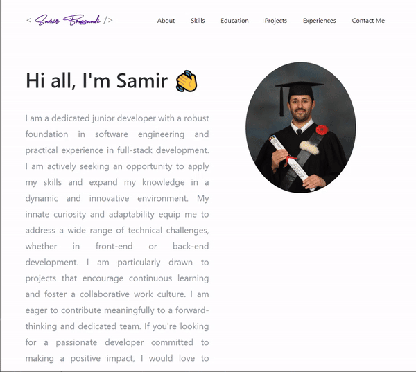

# Software Developer Portfolio using Angular ⚡️ 
## A clean, beautiful and responsive portfolio template for Developers!

<p align="center"> 
  <kbd>
</img>
  </kbd>
</p>


## Sections 
✔️ Summary and About me\
✔️ Skills\
✔️ Proficiency\
✔️ Work Experience\
✔️ Education Timeline\
✔️ Open Source Projects Connected with Github\
✔️ Contact me\
✔️ Github Profile
To view my live portfolio, **[click here](https://saboubh.github.io/Samir/)**

## Getting Started 🚀
These instructions will get you a copy of the project up and running on your local machine for development and testing purposes.

You'll need [Git](https://git-scm.com) and [Node.js](https://nodejs.org/en/download/) (which comes with [npm](http://npmjs.com)) installed on your computer.

```
node@v10.16.0 or higher
npm@6.9.0 or higher
git@2.17.1 or higher
Angular@8.0.2 or higher
```


## How To Use 🔧

From your command line, clone and run AngularFolio:
```bash
# Clone this repository
$ git clone https://github.com/saboubh/Samir.git


# Go into the repository
$ cd Samir

# Install dependencies
$ npm install
$ ng serve
```
## Github Setup For Open Source Projects

Generate a Github personal access token using these [Instructions](https://help.github.com/en/github/authenticating-to-github/creating-a-personal-access-token-for-the-command-line) `Make sure you don't select any scope just generate a simple token and place it under projects.components.ts>graphql.module.ts>token`
## Technologies used 🛠️

- [AngularJS](https://angularjs.org/)
- [graphql](https://graphql.org/) 
- [apollo-boost](https://www.apollographql.com/docs/react/get-started/) 

## Illustrations
- [UnDraw](https://undraw.co/illustrations)
